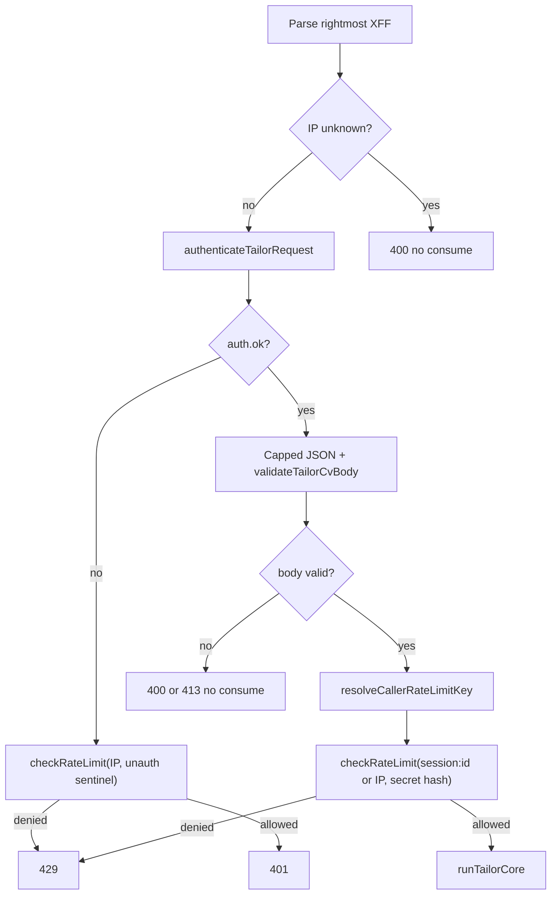

# feat: Per-user tailor rate-limit keys

## Goal Capsule

- **Objective:** Two signed-in frontend users sharing the BFF's loopback `x-forwarded-for` get independent CCC tailor ceilings; unsigned or header-spoofed identity cannot steal another user's bucket.
- **Means:** After successful shared-secret auth, key the existing per-caller Upstash bucket on a bounded body `sessionId` instead of the parsed client IP; keep the hashed-secret bucket as the global cap (KTD1, KTD2, KTD4).
- **Authority:** This plan. Companion contract: [ccc-frontend PR #21](https://github.com/mikkel250/ccc-frontend/pull/21). Historical dual-bucket anti-exfil: R21 / KTD7 in `docs/plans/2026-07-20-001-feat-json-curator-cv-pipeline-plan.md` (narrowed, not replaced — KTD6).
- **Stop when:** HTTP path keys authed `sessionId` vs IP as specified; secret cap still applies; inbox/`runTailorCore` still skips `RATE_LIMIT_*`; typecheck, lint, and `npm test` pass; PR opened linking the frontend companion. Do not merge or close any PR.

## Product Contract

### Summary

`POST /api/tailor-cv` already has two fail-closed Upstash windows: per-caller (`RATE_LIMIT_MAX`) and per hashed `TAILOR_API_KEY` (`RATE_LIMIT_SECRET_MAX`). The BFF in ccc-frontend #21 presents a valid Bearer, loopback XFF `127.0.0.1`, and a server-set body `sessionId` (Better Auth user id, never copied from the client). Today every BFF user shares one per-caller bucket. After this change, a successful auth plus a usable `sessionId` splits that bucket per user. Missing `sessionId` keeps rightmost-XFF keying (smoke CLI). Failed auth never honors `sessionId`. User identity is never read from inbound headers.

### Problem Frame

Frontend PR #13 would have forwarded client IPs so CCC could split its IP bucket. That trusts `x-forwarded-for` on hosts without a locked proxy. The owner wants every operator limited by Better Auth user id instead. The BFF already rate-limits in-process; CCC still collapses all BFF traffic onto `127.0.0.1` and, with default `RATE_LIMIT_SECRET_MAX` below `RATE_LIMIT_MAX`, the global secret cap fires before any per-user split can matter.

### Key Decisions

- **Do not trust inbound headers for user identity.** `(session-settled: user-directed — chosen over forwarding client IPs / honoring XFF as identity: spoofable off Vercel)` Governs R3, R5.
- **Body `sessionId` is the BFF-set user id, never copied from the client.** `(session-settled: user-directed — chosen over client-supplied identity: BFF derives it from the session)` Governs R2, R4.
- **Keep the hashed shared-secret bucket as the global cap.** `(session-settled: user-directed — chosen over dropping the secret window: stolen-key exfil still needs a backstop)` Governs R6, R7.
- **Unknown IP still 400 before any rate-limit consume.** `(session-settled: user-directed — keep current rightmost-XFF 400: smoke and BFF always send a valid IP)` Governs R1.

### Requirements

- R1. Missing, empty, oversized, or unparsable `x-forwarded-for` still returns `400 { error: "Cannot determine client IP" }` before `checkRateLimit`, even if the body would have contained `sessionId`.
- R2. When `authenticateTailorRequest` succeeds (`bearer` or existing `bypass`) and the JSON body has a usable `sessionId` (non-empty trimmed string, charset `A-Za-z0-9_-`, length 1..`RATE_LIMIT_SESSION_ID_MAX_CHARS`), the per-caller Upstash identifier is `session:<id>` — not the parsed IP.
- R3. User identity is never read from request headers (`x-forwarded-for` remains IP fallback only; no `x-user-id` or similar).
- R4. Failed auth never honors body `sessionId` (body is not required to choose the unauth caller key). Unauth traffic consumes the IP caller bucket plus the existing `unauth:missing` / `unauth:invalid` secret sentinels, then returns 401 or 429.
- R5. When auth succeeded but `sessionId` is omitted, empty, or fails the bound, the per-caller identifier stays the rightmost valid XFF IP (smoke CLI and other non-BFF callers). Invalid `sessionId` is not a 400.
- R6. `checkRateLimit` still checks the hashed-secret bucket first, then the per-caller bucket. Secret exhaustion must not burn per-caller quota. Success `remaining` / `resetTime` stay the more restrictive of the two.
- R7. `RATE_LIMIT_MAX` is the per-caller ceiling (IP or `session:` key). `RATE_LIMIT_SECRET_MAX` is the global cap. Both stay env-driven. Do not change shipped defaults in this change; document that the global cap must be raised above the per-caller cap (typically ≥ expected concurrent BFF users × `RATE_LIMIT_MAX`) or per-user splits cannot fire.
- R8. `runTailorCore` / inbox tailor still does not consume `RATE_LIMIT_*` buckets.
- R9. A spoofed `x-forwarded-for` does not change a usable authed `sessionId` bucket. Two usable `sessionId` values with the same XFF do not share a per-caller bucket.

### Actors

- A1. BFF (ccc-frontend #21): valid Bearer, XFF `127.0.0.1`, body `sessionId` = session user id.
- A2. Smoke CLI / direct API: valid Bearer, real or test XFF, optional `sessionId`.
- A3. Unauthenticated caller: missing/wrong Bearer; may send anything in body/headers.
- A4. Stolen-secret caller: valid Bearer, can rotate body `sessionId` (mitigated by R6/R7, not by trusting XFF).

### Key Flows

- F1. Authed BFF tailor — IP ok → auth ok → validate body → consume `session:<user>` + secret hash → 200 or 429.
- F2. Authed smoke without `sessionId` — IP ok → auth ok → validate body → consume IP + secret hash.
- F3. Failed auth — IP ok → consume IP + unauth sentinel → 401 or 429; body unread for identity.
- F4. Unknown IP — 400, no Redis consume.

### Acceptance Examples

- AE1. Same XFF `127.0.0.1`, valid Bearer, `sessionId` `user-a` then `user-b`: exhausting A's per-caller window does not 429 B. **Covers R2, R9.**
- AE2. Valid Bearer + usable `sessionId`, XFF `198.51.100.1` vs `198.51.100.2`: both hit the same `session:` bucket. **Covers R3, R9.**
- AE3. Valid Bearer, omitted `sessionId`, two different XFF values: independent IP buckets as today. **Covers R5.**
- AE4. Wrong Bearer, body `sessionId` of an existing user: that user's `session:` bucket is unchanged; unauth IP/sentinel buckets consume. **Covers R4.**
- AE5. Valid Bearer, distinct `sessionId`s, secret window smaller than the sum of per-caller windows: further requests 429 from the secret bucket while per-caller remaining would still allow. **Covers R6, R7.**
- AE6. No XFF, valid Bearer, body has `sessionId`: 400 `Cannot determine client IP`, `checkRateLimit` not called. **Covers R1.**
- AE7. `runTailorCore` success path does not call `checkRateLimit`. **Covers R8.**

### Scope Boundaries

- In: `buildTailorResponse` consume order, caller-key helper, `checkRateLimit` identifier (not a third limiter), env catalog + API/README comments, tests listed in Verification.
- Out: Frontend BFF code; trusting XFF as user identity; changing `RATE_LIMIT_SECRET_MAX` default; new `RATE_LIMIT_USER_MAX` limiter; inbox HTTP rate limits; merging or closing PRs.

### Deferred to Follow-Up Work

- Operator deploy: raise `RATE_LIMIT_SECRET_MAX` on Railway/production so BFF per-user caps can fire (documented, not auto-changed).
- Signed or attested `sessionId` so a stolen `TAILOR_API_KEY` cannot mint ids — not required while the secret cap remains the anti-exfil (KTD6).

## Planning Contract

### Key Technical Decisions

- KTD1. **Split consume, do not drop-in at the current call site.** `buildTailorResponse` today rate-limits with `"pre-body"` + IP before auth and before JSON. Honoring body `sessionId` requires: unknown-IP 400 first; failed auth consumes IP + unauth sentinel then 401/429 without reading `sessionId`; successful auth validates the body then consumes `session:<id>` or IP plus the matching secret hash. Authed invalid JSON/oversize JD no longer consume Redis (aligns with BFF #21; updates `tests/route.test.ts` "still rate-limits authorized invalid JSON"). Challenge to "swap the IP key inside `checkRateLimit`": the current call site never sees the body. Outcome: reorder, keep one dual-bucket `checkRateLimit`.
- KTD2. **Reuse the per-caller `Ratelimit` singleton; prefix the identifier `session:`.** Same `RATE_LIMIT_MAX` / `RATE_LIMIT_REDIS_PREFIX` limiter. `session:127.0.0.1` cannot collide with IP `127.0.0.1`. Challenge to "third limiter / `RATE_LIMIT_USER_MAX`": no evidence IP fallback and BFF users need different ceilings. Outcome: two knobs only (KTD4).
- KTD3. **Bound `sessionId` with charset `^[A-Za-z0-9_-]+$` and `RATE_LIMIT_SESSION_ID_MAX_CHARS` (default 128).** Fail closed to IP fallback, not 400. Resolve the key from the raw body field, never from `validateTailorCvBody`'s `ip:<addr>` fallback (that string is unused after validation today and would look like a session id).
- KTD4. **Keep `RATE_LIMIT_MAX` (per-caller) and `RATE_LIMIT_SECRET_MAX` (global).** Do not invert the secret default (`floor(RATE_LIMIT_MAX / 2)`). Document the interaction in `.env.example`, `README.md`, and `docs/api/API.md`: with defaults 5 and 2, two BFF users cannot each get 5 because the secret window is 2.
- KTD5. **Honor usable `sessionId` on any successful auth, including local `bypass`; do not require loopback XFF.** Loopback-only would read identity policy from a spoofable header (conflicts with R3). Direct API callers with the shared secret can rotate ids; R6 is the backstop.
- KTD6. **Narrow R21, do not drop it.** R21 forbids using client `sessionId` as the *anti-exfil* identity. This change keys only the per-caller bucket after server-side Bearer success; the hashed-secret bucket remains the exfil ceiling. Conflict call-out: anyone holding `TAILOR_API_KEY` can still mint `sessionId`s to bypass per-user caps — acceptable because they already hold the secret; document in the PR.

### High-Level Technical Design

`checkRateLimit` internally still: secret limiter first, then per-caller limiter, `moreRestrictive` merge, fail-closed `ServiceError` on Upstash timeout.

### Assumptions

- BFF #21 always sends a valid XFF (`127.0.0.1`) and a Better Auth user id matching the charset bound.
- Smoke may send `sessionId: smoke-<timestamp>`; that is a usable key and isolates runs — acceptable.
- Operator will raise `RATE_LIMIT_SECRET_MAX` in deployed env after reading the PR; this code change does not ship a looser default.

### Sequencing

U1 (caller-key helper + tests) → U2 (pipeline reorder + HTTP tests) → U3 (docs/env catalog). Execution note: TDD on U1 and U2.

### Sources and Research

- `app/api/lib/rate-limit.ts`, `app/api/lib/tailor-pipeline.ts` (consume is pre-auth / `"pre-body"`).
- `docs/solutions/upstash-redis-rate-limit-migration.md` — fail-closed timeout, `getRateLimitConfig()`, identifier via SDK `limit`.
- `docs/plans/2026-07-20-001-feat-json-curator-cv-pipeline-plan.md` R21 / KTD7.
- [ccc-frontend PR #21](https://github.com/mikkel250/ccc-frontend/pull/21) companion presentation.
- External research skipped: local dual-bucket pattern is established; the companion PR is the external contract. Bake-off skipped: a second pre-auth IP consume would still collapse BFF users on `127.0.0.1`; reorder is the only mechanism that unshares that bucket.

## Implementation Units

### U1. Caller-key helper and dual-bucket identifier

**Goal:** A pure function chooses `session:<id>` vs raw IP; `checkRateLimit` applies that string as the per-caller identifier.

**Requirements:** R2, R3, R5, R6, R7, R9 (unit-level keying). Cites KTD2, KTD3, KTD4.

**Dependencies:** None.

**Files:**
- `app/api/lib/rate-limit.ts` — add `resolveCallerRateLimitKey` / `isUsableRateLimitSessionId`; keep dual `Ratelimit` singletons; `checkRateLimit(callerIdentifier, secretBucketKey)` (drop the unused `_sessionId` first argument, update `TailorPipelineDeps` in U2).
- `tests/rate-limit.test.ts` — replace "rate limits by identifier regardless of sessionId" with prefix/charset tests; keep secret-first and global-cap tests.
- `scripts/verify-rate-limit.ts` — two-arg call.
- `.env.example` — `RATE_LIMIT_SESSION_ID_MAX_CHARS` (U3 can finish comments; declare the var here so U1 compiles against `getEnvNumber`).

**Approach:** Existing `checkRateLimit` already keys the IP limiter on whatever string it is given. Extend with a helper: auth-ok + usable sessionId → `session:` + trimmed id; otherwise return the IP. Charset/length from env via `getEnvNumber("RATE_LIMIT_SESSION_ID_MAX_CHARS", 128)`. Do not add a third `Ratelimit` instance. Preserve secret-first sequential `runLimit` and fail-closed timeout.

**Execution note:** Test-first. See red on prefix collision and charset fallback before changing production helpers.

**Test scenarios:**
- Happy: usable id `user_a-1` → identifier `session:user_a-1`; IP argument ignored for the caller key.
- Edge: `sessionId` equal to an IP string still prefixes (`session:127.0.0.1` ≠ `127.0.0.1`).
- Edge: empty, whitespace, 129-char, or `user@id` → returns the IP.
- Error: two different usable ids with the same IP do not share the per-caller mock bucket; same usable id with two IPs does.
- Integration: secret bucket still 429s first and does not increment the per-caller limiter when the secret window is exhausted (existing coverage, keep green).

**Verification:** `node --import tsx --test tests/rate-limit.test.ts`

### U2. Pipeline consume order and HTTP identity tests

**Goal:** `buildTailorResponse` implements F1–F4 so BFF users split and unauth cannot target a `session:` bucket.

**Requirements:** R1–R9. Cites KTD1, KTD5, KTD6.

**Dependencies:** U1.

**Files:**
- `app/api/lib/tailor-pipeline.ts` — reorder; pass resolved caller identifier; read raw body `sessionId` for the helper, not validation fallback.
- `app/api/lib/tailor-cv-deps.ts` — `checkRateLimit` arity.
- `tests/route.test.ts` — AE1–AE6; flip authorized invalid JSON to assert `checkRateLimit` call count 0.
- `tests/tailor-pipeline.test.ts` — event order: unknown-IP; failed-auth consume; authed consume after validate; `runTailorCore` still no `checkRateLimit`.

**Approach:** Keep step 1 IP 400. Authenticate next. On `!auth.ok`, `checkRateLimit(ip, unauth sentinel)` then return 429 or the auth status. On success, capped body + validate; on 400/413 return without consume. Then `resolveCallerRateLimitKey({ sessionId: rawFromBody, ipAddress })` and `checkRateLimit(caller, valid-secret-hash)`. Do not inspect headers for identity. Bypass mode is `auth.ok` and may honor `sessionId`.

**Execution note:** Test-first on route/pipeline identity cases, including the inverted invalid-JSON consume test.

**Test scenarios:**
- Happy: AE1 two sessionIds, same XFF, valid auth — independent buckets.
- Happy: AE3 omitted sessionId — rightmost XFF buckets.
- Edge: AE2 spoofed XFF does not change a `session:` bucket.
- Error: AE4 wrong Bearer + victim `sessionId` — victim bucket untouched; 401 or 429 from IP/sentinel.
- Error: AE6 missing XFF + sessionId in body → 400, limiter not called.
- Error: authorized trailing-comma JSON → 400, limiter not called (behavior change).
- Error: failed-auth still exhausts IP window to 429 (keep).
- Integration: AE5 global secret cap still 429s across distinct `session:` keys.
- Integration: AE7 `runTailorCore` does not call `checkRateLimit`.

**Verification:** `node --import tsx --test tests/rate-limit.test.ts tests/route.test.ts tests/tailor-pipeline.test.ts`

### U3. Catalog and contract docs

**Goal:** Operators see how per-caller and global caps interact and that `sessionId` now keys the per-caller bucket only after auth.

**Requirements:** R2, R7. Cites KTD4, KTD6.

**Dependencies:** U1, U2.

**Files:**
- `.env.example` — rate-limit comment block: per-caller vs global; raise `RATE_LIMIT_SECRET_MAX` for multi-user BFF; `RATE_LIMIT_SESSION_ID_MAX_CHARS`.
- `README.md` — env table line.
- `docs/api/API.md` — Rate Limiting section and `sessionId` field description.
- `docs/arch/APP_WALKTHROUGH.md` — request order if it still lists parse-before-rate-limit (code is source of truth).
- `docs/test/TESTING.md` — 429 row if it still says IP-only.

**Approach:** State: `RATE_LIMIT_MAX` applies to whichever per-caller key was chosen (`session:<id>` or IP). `RATE_LIMIT_SECRET_MAX` is process-wide for a valid Bearer. Defaults 5 / 2 mean the secret window wins first. Do not rewrite historical R21 plans.

**Test expectation:** none — docs/env catalog. Cross-file invariant already covered if an existing test pins `.env.example` names; do not add prose assertions.

**Verification:** grep `sessionId does not key` is gone from `docs/api/API.md`; `.env.example` names the new var.

## Verification Contract

- `npx tsc --noEmit`
- `npm run lint`
- `npm test`
- Targeted while red/green: `node --import tsx --test tests/rate-limit.test.ts tests/route.test.ts tests/tailor-pipeline.test.ts`
- `npm run smoke` is live-API and is not required for this change.

## Definition of Done

- U1–U3 complete; abandoned experiments removed from the diff.
- AE1–AE7 have automated coverage.
- Typecheck, lint, full test suite green.
- PR body links https://github.com/mikkel250/ccc-frontend/pull/21, explains per-caller vs global env interaction, and does not merge/close PRs.
